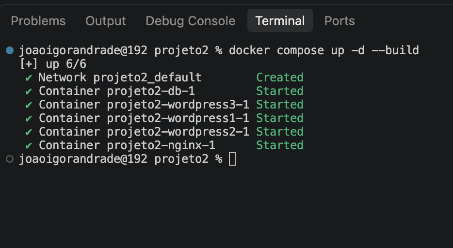
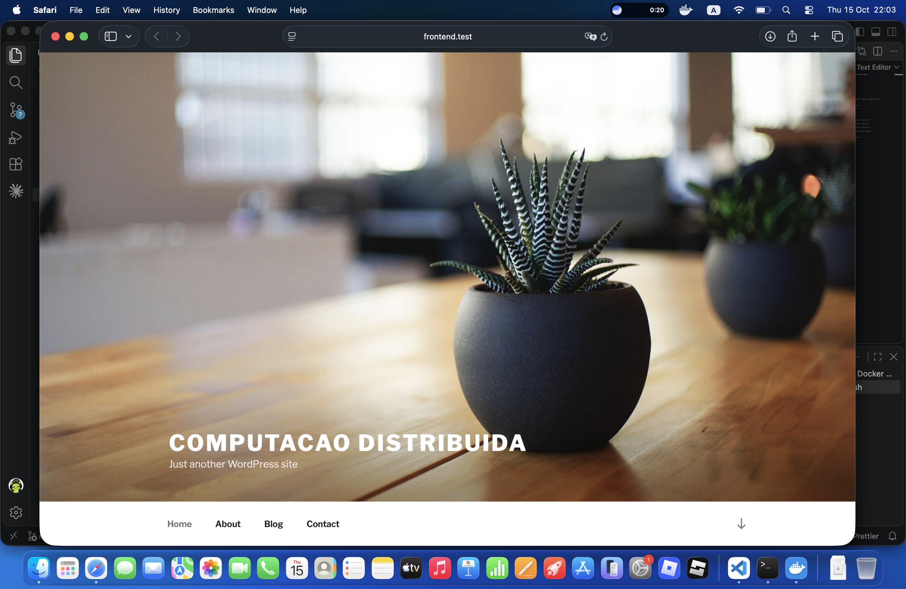
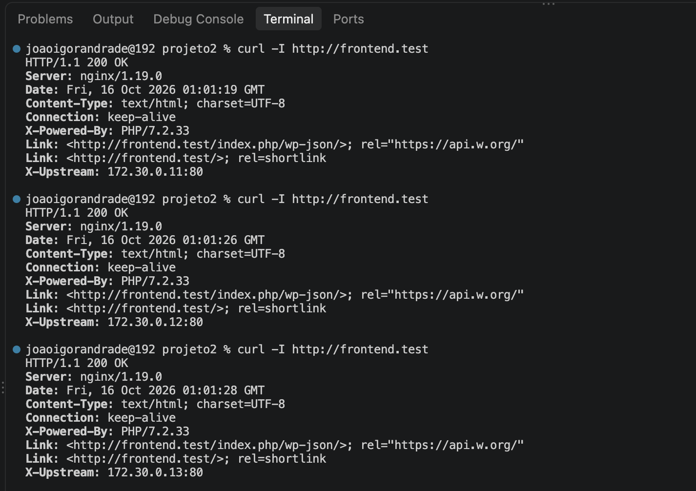
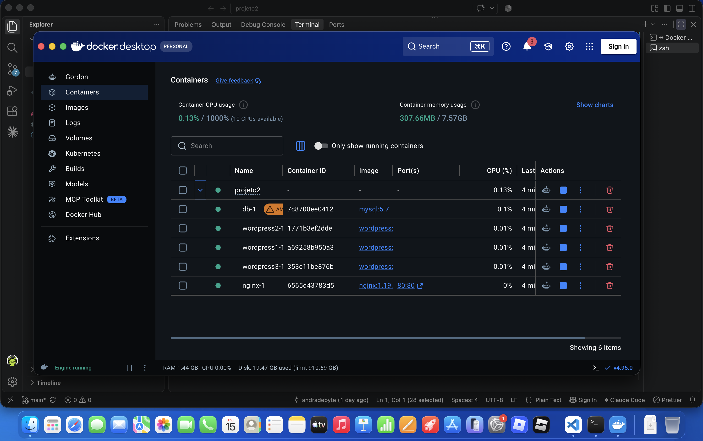

# Projeto 2 – WordPress com Múltiplas Instâncias, Nginx e Docker Compose

Trabalho 2 da disciplina: executar múltiplas instâncias do WordPress para aumentar a escalabilidade, usando o **Nginx como balanceador de carga** e o **Docker Compose** para orquestrar tudo.

## Sobre o projeto

O balanceamento de carga distribui as requisições entre várias instâncias de uma aplicação, otimizando o uso de recursos, aumentando a taxa de transferência, reduzindo a latência e dando tolerância a falhas. O Nginx, projetado para alto volume de requisições simultâneas, é usado aqui como balanceador HTTP na frente de três instâncias do WordPress que compartilham o mesmo banco de dados.

## Arquitetura

Cinco contêineres, definidos em `docker-compose.yml`:

```
                 ┌──► wordpress1 ──┐
Cliente ──► nginx ──► wordpress2 ──┼──► mysql
                 └──► wordpress3 ──┘
```

| Contêiner | Imagem | Função |
|---|---|---|
| `nginx` | `nginx:1.19.0` | Recebe as requisições na porta 80 e as distribui entre os WordPress |
| `wordpress1`, `wordpress2`, `wordpress3` | `wordpress:5.4.2-php7.2-apache` | Instâncias da aplicação (IPs fixos 172.30.0.11, .12 e .13) |
| `db` | `mysql:5.7` | Banco de dados único, compartilhado pelas três instâncias |

## Como foi feito

- **Nginx (`nginx.conf`)**: o bloco `upstream wordpress` agrupa `wordpress1`, `wordpress2` e `wordpress3`. O `location /` repassa tudo via `proxy_pass http://wordpress` e adiciona o cabeçalho `X-Upstream` com o endereço da instância que respondeu. Sem outra diretiva, o Nginx usa o algoritmo **Round Robin**.
- **Banco compartilhado**: os três WordPress usam as mesmas variáveis `WORDPRESS_DB_*` apontando para o `db`, então todos exibem o mesmo conteúdo.
- **Volumes**: a pasta `/var/www/html` dos WordPress é compartilhada com o host em `./data/wordpress`, e o Nginx a monta em `/usr/share/nginx/html`. O banco persiste em `./data/db`.
- **Isolamento**: apenas o `nginx` publica porta (80). WordPress e MySQL não são acessíveis diretamente pelo host, só pela rede interna do Compose.
- **Logs**: os logs do Nginx ficam na pasta `./logs`.

## Como executar

Adicione o domínio ao `/etc/hosts`:

```
127.0.0.1   frontend.test
```

Suba os contêineres:

```bash
docker compose up -d
docker compose ps
```

## Containers em execução



## Website funcionando

Acesso em `http://frontend.test`.



## Balanceamento de carga (Round Robin)

Execução repetida do comando abaixo. O cabeçalho `X-Upstream` alterna entre os três IPs dos WordPress (172.30.0.11, .12 e .13), comprovando a distribuição Round Robin.

```bash
curl -I http://frontend.test
```



## Docker Desktop



## Conclusão

A arquitetura com Nginx na frente de três instâncias do WordPress e um único MySQL funcionou como esperado: as requisições são distribuídas em Round Robin entre as instâncias, todas servem o mesmo conteúdo e apenas o Nginx fica exposto ao host.
